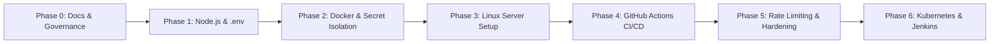

# Dockerized Service — Phase-Wise Architecture & Planning Blueprint

> **Project Basis:** `roadmap.sh` — *Dockerized Service: Use GitHub Actions to Deploy a Dockerized Node.js Service*
> **Status:** Phases 0–5 Code, Infra, CI/CD & Documentation Implemented (Ready for Docker Desktop & Cloud Deployment)

This repository contains the complete, phase-wise product, technical, security, frontend/integration, and execution documentation for building, containerizing, hosting, and continuously deploying a Node.js service with Basic Authentication and strict secrets management.

---

## Documentation Suite

| # | Document | Purpose | File |
| :--- | :--- | :--- | :--- |
| **01** | **Product Requirements Document (PRD)** | Problem statement, target users, vision, core features (Must/Should/Nice), user & CI/CD flows, MVP scope, explicit non-goals, and success metrics | [`docs/01-prd.md`](./docs/01-prd.md) |
| **02** | **Technical Architecture Document** | Recommended tech stack & versions, phase-wise system architecture, planned file & folder tree, configuration/state schemas, and environment rules | [`docs/02-technical-architecture.md`](./docs/02-technical-architecture.md) |
| **03** | **Security & Access Document** | HTTP Basic Auth design, role permissions matrix, RLS & multi-layer isolation boundaries, error-handling matrix, and pre-launch edge cases | [`docs/03-security-and-access.md`](./docs/03-security-and-access.md) |
| **04** | **Frontend & Integration Specification** | Visual design system (hex palette, typography, components, spacing) for browser views + complete HTTP API, GHCR, GitHub Actions, and SSH integration specs | [`docs/04-frontend-specification.md`](./docs/04-frontend-specification.md) |
| **05** | **Feature Ticket List** | AI-ready, phase-wise build tickets with descriptions, acceptance criteria, dependencies, and priorities | [`docs/05-feature-ticket-list.md`](./docs/05-feature-ticket-list.md) |

---

## Phase-Wise Execution Architecture

The project is strictly divided into **5 sequential phases** so each layer is verified locally and securely before moving to the next:

| Phase | Name | Primary Objective | Exit Gate (Definition of Done) |
| :--- | :--- | :--- | :--- |
| **Phase 0** | **Planning & Governance** | Lock down PRD, architecture, security, UI/API specs, and tickets before writing code | All 5 docs reviewed and signed off |
| **Phase 1** | **Node.js Service & Local Config** | Build Express app with `/`, `/secret` (Basic Auth), `/health`, and `.env` configuration | Automated tests pass locally; `/` returns `Hello, world!`; `/secret` prompts & validates credentials |
| **Phase 2** | **Containerization & Secret Isolation** | Write `Dockerfile` & `.dockerignore`; build and run image locally | Image runs cleanly via `--env-file .env`; `.env` is proven absent from image layers |
| **Phase 3** | **Remote Linux Server Setup** | Provision Ubuntu VM (DigitalOcean/AWS), configure SSH key access, UFW firewall, and Docker Engine | Non-root deploy user can run Docker via SSH; firewall blocks unnecessary ports |
| **Phase 4** | **CI/CD Pipeline (GitHub Actions)** | Automate build, push to `ghcr.io`, and SSH deployment using GitHub Secrets | Push to `main` automatically deploys updated container and passes live health & route checks |
| **Phase 5** | **Hardening & Optional Enhancements** | Add HTTPS (Caddy/Nginx), rate limiting, IaC (Terraform/Ansible), and rollback verification | TLS active on public endpoint; brute-force & crash-recovery edge cases verified |
| **Phase 6** | **Kubernetes & Jenkins Orchestration** | Deploy via K8s manifests / Helm chart and run automated CI/CD via Jenkins declarative pipeline | Rolling update healthy, HPA active, Jenkins pipeline stages pass green |

---

## Current Repository State

- **Phase 0 (Docs):** [`docs/01-prd.md`](./docs/01-prd.md) – [`docs/05-feature-ticket-list.md`](./docs/05-feature-ticket-list.md)
- **Phase 1 (Node.js Service):** [`src/`](./src/) and [`tests/`](./tests/) (24/24 unit/route tests passing)
- **Phase 2 (Dockerization):** [`Dockerfile`](./Dockerfile) and [`.dockerignore`](./.dockerignore) (verified on live engine; 0 secrets in layers)
- **Phase 3 (Remote Server & IaC):** [`infra/`](./infra/) ([`server-setup.sh`](./infra/server-setup.sh), [`Caddyfile`](./infra/Caddyfile), Terraform, Ansible)
- **Phase 4 (GitHub Actions):** [`.github/workflows/deploy.yml`](./.github/workflows/deploy.yml), [`.github/DEPLOYMENT_CHECKLIST.md`](./.github/DEPLOYMENT_CHECKLIST.md)
- **Phase 5 (Hardening):** [`src/middleware/rateLimit.js`](./src/middleware/rateLimit.js) (sliding-window IP limiter)
- **Phase 6 (Kubernetes & Jenkins):**
  - **Kubernetes Manifests:** [`k8s/manifests/`](./k8s/manifests/) (Deployment, Service, Ingress, HPA, ConfigMap, Secret, Kustomize)
  - **Helm Chart:** [`k8s/helm/dockerized-service/`](./k8s/helm/dockerized-service/)
  - **Jenkins Pipeline:** [`Jenkinsfile`](./Jenkinsfile)
  - **Local Jenkins Setup:** [`infra/jenkins/`](./infra/jenkins/) ([`docker-compose.yml`](./infra/jenkins/docker-compose.yml) + [README.md](./infra/jenkins/README.md))
