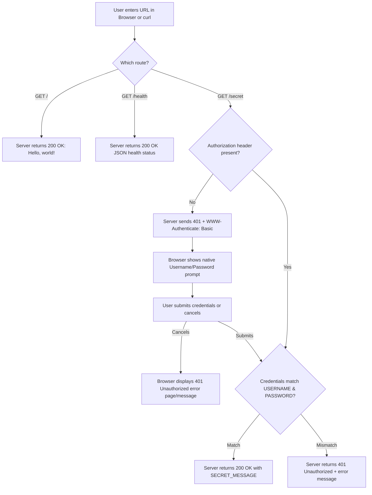

# 01 — Product Requirements Document (PRD)

**Project:** Dockerized Service (Node.js + Docker + Remote Linux + GitHub Actions CI/CD)
**Version:** 1.0
**Scope:** End-to-end delivery from local Node.js service to automated cloud container deployment

---

## 1. Problem Statement

Building a small web service on a developer's laptop is easy, but getting that service onto a live server reliably and safely is where most beginners and small teams get stuck. Without proper packaging and automation, three painful problems happen repeatedly:

1. **"It works on my machine" failures:** Code runs locally on Windows or macOS, then breaks on a Linux server because of missing Node.js versions, wrong dependencies, or environment differences.
2. **Accidental secret leaks:** Developers accidentally bundle `.env` files, passwords, or API keys directly into container images or Git history, exposing sensitive credentials to anyone who pulls the image or views the repository.
3. **Manual, error-prone deployments:** Logging into a server by hand every time code changes, pulling files, and restarting processes takes too much time and easily causes downtime or missed steps.

This project solves all three problems by creating a clean, repeatable pipeline: a lightweight Node.js service with protected access, packaged into a secret-free Docker image, deployed automatically to a remote Linux server whenever code is pushed to GitHub.

---

## 2. Target Users

### Primary User: Early-Career / Intermediate Developer Learning DevOps
- **Age / Profile:** 19–35 years old; software engineering student, junior/mid developer, or indie maker.
- **Tech Comfort Level:** Comfortable writing basic JavaScript/Node.js and using Git, `curl`, and a terminal; learning Docker, Linux server administration, and CI/CD pipelines.
- **What They Want:** A working, real-world reference implementation showing how an app goes from local `.env` code to an automatically deployed container on a live cloud server without leaking secrets.
- **What Frustrates Them:** Overly complex enterprise tutorials (like full Kubernetes clusters) when they just want one clean service running reliably; vague deployment guides that skip firewall, SSH, or `.env` exclusion details.

### Secondary User: End Visitor / Automated Verifier
- **Profile:** Anyone opening the deployed URL in a browser, or an evaluator/automated check hitting the endpoints with `curl` or Postman.
- **What They Want:** Instant response on `/` (`Hello, world!`), a clear credential prompt when visiting `/secret`, immediate reveal of the secret message with valid credentials, and a clear error message when credentials are invalid.

---

## 3. Product Vision

> Turn a two-route Node.js application into a production-grade, secret-safe, self-deploying containerized service that ships automatically from a `git push` to a live Linux server in under three minutes.

---

## 4. Core Features (Phase-Wise Classification)

### Phase 1: Node.js Service & Local Configuration

| Feature ID | Feature Name | Description | Priority |
| :--- | :--- | :--- | :--- |
| **F-1.1** | Public Root Route (`GET /`) | Returns `Hello, world!` with HTTP `200 OK` so anyone can verify the service is live. | **Must-Have** |
| **F-1.2** | Protected Secret Route (`GET /secret`) | Protected by HTTP Basic Authentication. Prompts browser visitors for username/password; returns `SECRET_MESSAGE` on match and a clear error message on mismatch. | **Must-Have** |
| **F-1.3** | Local `.env` Config & `.env.example` | Loads `SECRET_MESSAGE`, `USERNAME`, `PASSWORD`, and optional `PORT` from `.env` locally, with startup validation so missing variables fail clearly. | **Must-Have** |
| **F-1.4** | Health Check Endpoint (`GET /health`) | Returns `200 OK` JSON status (never exposing secrets) for Docker health checks and deployment verification. | **Should-Have** |
| **F-1.5** | Automated Route Test Suite | Unit and integration tests verifying `/`, `/secret` (missing, wrong, and valid credentials), and env validation. | **Should-Have** |

### Phase 2: Dockerization & Image Hygiene

| Feature ID | Feature Name | Description | Priority |
| :--- | :--- | :--- | :--- |
| **F-2.1** | Production `Dockerfile` | Builds a lean Node.js Alpine container running as a non-root user on port `3000`. | **Must-Have** |
| **F-2.2** | `.dockerignore` Secret Exclusion | Explicitly prevents `.env`, `.git`, `node_modules`, and local artifacts from entering the Docker build context or final image. | **Must-Have** |
| **F-2.3** | Local Container Run & Leak Audit | Verified workflow for running the image locally with `--env-file .env` and asserting `.env` is absent inside the container filesystem. | **Must-Have** |

### Phase 3: Remote Linux Server Provisioning

| Feature ID | Feature Name | Description | Priority |
| :--- | :--- | :--- | :--- |
| **F-3.1** | Cloud Linux VM & SSH Key Setup | Ubuntu 24.04 LTS server provisioned on DigitalOcean/AWS with SSH key-only authentication and a dedicated deploy user. | **Must-Have** |
| **F-3.2** | Docker Engine & Firewall (UFW) | Docker installed on the server; firewall permits only SSH (`22`) and web traffic (`80`/`443` or `3000`). | **Must-Have** |
| **F-3.3** | Reverse Proxy & Automatic HTTPS | Caddy or Nginx sitting in front of container port `3000` to serve traffic over HTTPS so Basic Auth headers are encrypted in transit. | **Should-Have** |
| **F-3.4** | Infrastructure-as-Code (Terraform/Ansible) | Optional automated server provisioning and Docker bootstrap scripts instead of manual SSH setup. | **Nice-to-Have** |

### Phase 4: CI/CD Pipeline & Secrets Management (GitHub Actions)

| Feature ID | Feature Name | Description | Priority |
| :--- | :--- | :--- | :--- |
| **F-4.1** | Automated Test & Docker Build Job | Runs tests, builds the Docker image on push to `main`, and tags it with commit SHA and `latest`. | **Must-Have** |
| **F-4.2** | Container Registry Push (`ghcr.io`) | Logs in using GitHub Secrets/Tokens and pushes the built image to GitHub Container Registry (or Docker Hub). | **Must-Have** |
| **F-4.3** | Automated Remote SSH Deployment | Connects to the Linux server using GitHub Secrets, pulls the new image, swaps the running container, and passes runtime secrets safely. | **Must-Have** |
| **F-4.4** | Post-Deploy Smoke Test & Rollback Guard | Verifies `/`, `/health`, and `/secret` after container startup; fails the workflow cleanly if health check fails. | **Should-Have** |
| **F-4.5** | Browser HTML Presentation Templates | Content-negotiated clean HTML views for `/secret`, `401` error, and `404` error when opened in a web browser, while preserving raw text for `curl`. | **Nice-to-Have** |

---

## 5. App Flow (End-to-End Walkthrough)

### Flow A: End-User Visiting the Live Service

1. **Landing on `/`:** User opens `http(s)://<server>/` -> immediately sees `Hello, world!`. No login needed.
2. **Visiting `/secret`:** User navigates to `/secret`.
3. **Credential Prompt:** Because no valid `Authorization` header was sent yet, the server responds with `401 Unauthorized` and `WWW-Authenticate: Basic`. The browser pops up a native Username & Password prompt.
4. **Correct Login:** User enters matching `USERNAME` and `PASSWORD` and clicks Sign In -> server validates them and displays `SECRET_MESSAGE`.
5. **Wrong Login / Cancel:** User enters an incorrect username or password -> browser re-prompts or displays the server's clear `401 Unauthorized` error message (`Invalid credentials. Access to /secret denied.`).

### Flow B: Developer Push & Automated Deployment Flow

1. Developer updates code locally and runs tests (`Phase 1`).
2. Developer verifies local Docker build without `.env` baked in (`Phase 2`).
3. Developer runs `git push origin main`.
4. **GitHub Actions triggers:**
   - **Step 1 (Verify):** Checks out code, runs unit/route tests.
   - **Step 2 (Build & Push):** Builds Docker image (excluding `.env`), logs into `ghcr.io`, pushes tagged image (`:<sha>` and `:latest`).
   - **Step 3 (Deploy):** Connects via SSH to the remote Linux server using stored GitHub Secrets, pulls the new image, gracefully replaces the running container, and injects `SECRET_MESSAGE`, `USERNAME`, `PASSWORD` as runtime environment variables.
   - **Step 4 (Smoke Check):** Hits `/health` and `/` to confirm the new version is live.

---

## 6. What the MVP Looks Like (Phase-by-Phase Deliverables)

- **MVP Checkpoint 1 (End of Phase 1):** A runnable Node.js service on `localhost:3000` with working `/`, `/secret` Basic Auth, `.env` loading, and automated tests passing.
- **MVP Checkpoint 2 (End of Phase 2):** A reproducible Docker image runnable locally via `docker run -p 3000:3000 --env-file .env`, confirmed to contain zero `.env` files inside the image.
- **MVP Checkpoint 3 (End of Phase 3):** A hardened remote Linux server ready with Docker and SSH access.
- **Full V1 Launch (End of Phase 4):** Every push to `main` automatically builds, pushes to `ghcr.io`, and updates the live service on the remote Linux server with zero manual SSH steps.

---

## 7. What We Are Deliberately NOT Building in Version 1

To stay focused and avoid over-engineering, the following are **explicitly excluded from V1**:

1. **No Database (PostgreSQL / MongoDB / Redis):** Credentials and secret message come strictly from environment variables (`.env` locally, runtime secrets in production).
2. **No Multi-User Accounts, Sign-Up, or OAuth Flows:** Single configured credential pair (`USERNAME` / `PASSWORD`) as defined in requirements.
3. **No Admin Dashboard or Web CMS:** Secrets are managed via `.env` / GitHub Actions Secrets, not a database-backed admin panel.
4. **No Kubernetes / Swarm / Multi-Region Load Balancing:** Single remote Linux VM running a single Docker container is the right operational footprint for V1.
5. **No Payment Processing or SaaS Tenancy:** This is a single-service deployment reference and utility service.

---

## 8. Success Metrics

| Metric | Target | How Measured |
| :--- | :--- | :--- |
| **Functional Route Accuracy** | `100%` pass rate across `/`, `/secret` (valid/invalid/missing auth), and `/health` | Automated test suite + post-deploy curl checks |
| **Secret Isolation Compliance** | `0` `.env` files or hardcoded secrets inside Git history or Docker image layers | `git ls-files`, `.dockerignore` inspection, and `docker run --rm  ls -la` audit |
| **Deployment Automation** | `0` manual SSH steps required for routine code updates | Successful end-to-end GitHub Actions run on push to `main` |
| **CI/CD Lead Time** | `< 3 minutes` from `git push` to live container healthy | GitHub Actions workflow duration logs |
| **Service Availability Post-Deploy** | Container passes `/health` within `10 seconds` of restart | Docker `HEALTHCHECK` + CI smoke test |
