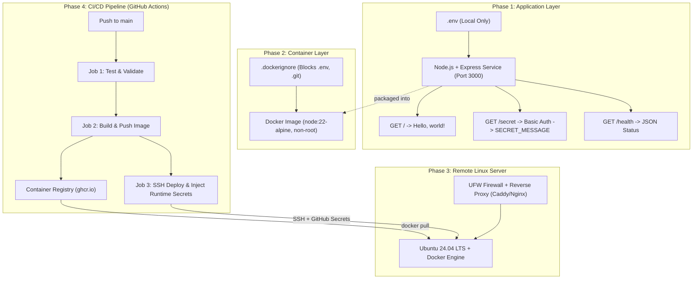

# 02 — Technical Architecture Document

**Project:** Dockerized Service (Node.js + Docker + Remote Linux + GitHub Actions CI/CD)
**Version:** 1.0
**Scope:** Engineering blueprint covering Tech Stack, Phase-Wise System Architecture, File/Folder Map, Data/Config Schemas, and Environment Rules

---

## 1. Phase-Wise System Architecture

The system spans four progressive engineering boundaries: **Application Runtime (Phase 1)** -> **Container Artifact (Phase 2)** -> **Remote Linux Host (Phase 3)** -> **Automated CI/CD Pipeline (Phase 4)**.



---

## 2. Recommended Tech Stack (With Reasoning & Versions)

| Layer | Choice & Version | Why This Choice |
| :--- | :--- | :--- |
| **Runtime** | **Node.js `22.x LTS`** | Long-Term Support stability, native `node:test` test runner, native `crypto.timingSafeEqual`, fast startup, and small Alpine base images. |
| **Web Framework** | **Express `4.21.x`** | Minimal, battle-tested HTTP routing with clean middleware architecture for Basic Auth, error handling, and content negotiation without framework bloat. |
| **Config Loader** | **`dotenv` `16.4.x`** | Standard `.env` loading in local development; cleanly bypassed in production containers when runtime env vars are already injected by Docker. |
| **Automated Testing** | **Node.js `node:test` + `supertest` `7.x`** | Zero-config built-in test runner paired with lightweight HTTP assertions for testing `/`, `/secret`, `/health`, and auth edge cases without Jest/Vitest setup overhead. |
| **Linting / Quality** | **ESLint `9.x` (flat config)** | Catches syntax issues, unused vars, and inconsistent code style before commits or CI runs. |
| **Containerization** | **Docker (`node:22-alpine`)** | Alpine Linux keeps the final image tiny (~130–160 MB instead of ~1 GB), reduces attack surface, and includes an existing non-root `node` user. |
| **Container Registry** | **GitHub Container Registry (`ghcr.io`)** | Integrated directly with GitHub via `GITHUB_TOKEN` (no extra Docker Hub credentials needed by default, though Docker Hub works identically if preferred). |
| **CI/CD Platform** | **GitHub Actions** | Native to GitHub; supports `docker/build-push-action`, encrypted Repository/Environment Secrets, and automated SSH deployment on push to `main`. |
| **Remote Server** | **Ubuntu `24.04 LTS` (DigitalOcean Droplet / AWS EC2)** | Long-term OS security patches until 2029, first-class Docker Engine packages, and straightforward `ufw` firewall management. |
| **Reverse Proxy (Phase 3/5)** | **Caddy `2.x`** *(Recommended)* or **Nginx** | Automatically provisions and renews Let's Encrypt HTTPS certificates in 4 lines of config — critical because HTTP Basic Auth encodes credentials in Base64, not encryption. |
| **IaC (Optional Phase 3)** | **Terraform + Ansible / Cloud-Init** | Repeatable server provisioning so infrastructure can be rebuilt from scratch without manual click-ops. |

---

## 3. Complete Planned File & Folder Structure

> **Note:** No source files have been generated yet. The structure below defines the exact target repository layout and the phase in which each file is introduced.

```text
KGAS PROJECT/
├── README.md                          # [Phase 0] Master overview & phase-wise doc index
├── docs/                              # [Phase 0] Complete architecture & planning specs
│   ├── 01-prd.md                      #   Product Requirements Document
│   ├── 02-technical-architecture.md   #   Technical Architecture Document (this file)
│   ├── 03-security-and-access.md      #   Security & Access Document
│   ├── 04-frontend-specification.md   #   Frontend & External Integration Spec
│   └── 05-feature-ticket-list.md      #   Phase-wise AI-ready Feature Ticket List
│
├── src/                               # [Phase 1] Node.js application source code
│   ├── index.js                       #   Server bootstrap, startup env validation, graceful shutdown
│   ├── app.js                         #   Express app factory (routes, middleware, error handlers)
│   ├── config/
│   │   └── env.js                     #   Loads & validates PORT, NODE_ENV, SECRET_MESSAGE, USERNAME, PASSWORD
│   ├── middleware/
│   │   ├── basicAuth.js               #   HTTP Basic Auth parser & constant-time validator
│   │   └── errorHandler.js            #   404 & global 500 error handlers (never leaks secrets/stack in prod)
│   ├── routes/
│   │   ├── index.js                   #   GET / ("Hello, world!") & GET /health
│   │   └── secret.js                  #   GET /secret (protected by basicAuth middleware)
│   └── views/                         #   [Phase 4/Nice-to-Have] Clean HTML response templates
│       └── templates.js               #   Styled HTML builders for browser visits (/secret, 401, 404)
│
├── tests/                             # [Phase 1] Automated unit & integration tests
│   ├── config.test.js                 #   Env validation & missing-var failure tests
│   ├── routes.test.js                 #   GET /, GET /health, GET /secret (valid/invalid/missing auth)
│   └── basicAuth.test.js              #   Edge cases (colons in password, empty header, malformed base64)
│
├── .env.example                       # [Phase 1] Safe template listing required env keys (no real secrets)
├── .env                               # [Phase 1] Local secrets ONLY (Git-ignored & Docker-ignored; NEVER committed)
├── .gitignore                         # [Phase 1] Excludes node_modules/, .env, coverage/, *.log
├── package.json                       # [Phase 1] Scripts (start, dev, test, lint) & dependencies
├── eslint.config.mjs                  # [Phase 1] Linting rules
│
├── Dockerfile                         # [Phase 2] Multi-stage / slim Alpine container definition (non-root)
├── .dockerignore                      # [Phase 2] Excludes .env, .env.*, .git, node_modules, docs, tests
│
├── infra/                             # [Phase 3] Server setup & optional IaC / reverse proxy configs
│   ├── server-setup.sh                #   Idempotent Ubuntu bootstrap guide/script (Docker + UFW + deploy user)
│   ├── Caddyfile                      #   Optional HTTPS reverse proxy config (80/443 -> localhost:3000)
│   └── ansible-or-terraform/          #   Optional IaC templates (Phase 3/5 Nice-to-Have)
│
└── .github/                           # [Phase 4] GitHub Actions CI/CD workflows
    └── workflows/
        └── deploy.yml                 #   Test -> Build Docker -> Push to GHCR -> SSH Deploy -> Smoke Test
```

### Folder Responsibility Rules
- **`src/`**: Contains only runtime application logic. Never stores secrets or infrastructure credentials.
- **`tests/`**: Contains isolated tests that inject mock environment variables in memory rather than depending on production credentials.
- **`infra/`**: Contains server provisioning documentation, firewall setup, and reverse proxy templates; no private SSH keys are ever stored here.
- **`.github/workflows/`**: Contains declarative CI/CD pipelines that reference GitHub Encrypted Secrets exclusively via `${{ secrets.* }}`.

---

## 4. Data, Configuration & State Schema (Plain-English "Tables")

Because V1 is an **intentionally stateless microservice**, it does **not** run a persistent SQL or NoSQL database engine. Instead, all system data lives in well-defined **configuration, request/auth, artifact, and deployment schemas**. Think of these like structured spreadsheets governing each phase:

### Table 1: `EnvironmentConfig` (Runtime Configuration Sheet — Phase 1 & 2)

| Field Name | Type | Required | Default | Description & Rules |
| :--- | :--- | :--- | :--- | :--- |
| `PORT` | Integer (`1–65535`) | No | `3000` | TCP port the Express HTTP server listens on inside the host or container. |
| `NODE_ENV` | Enum (`development`, `test`, `production`) | No | `development` | Controls error verbosity (`production` hides stack traces). |
| `SECRET_MESSAGE` | Non-empty String | **Yes** | None | Secret payload returned on authenticated `GET /secret`. |
| `USERNAME` | Non-empty String | **Yes** | None | Expected Basic Auth username. |
| `PASSWORD` | Non-empty String | **Yes** | None | Expected Basic Auth password. |

**Relationship:** Loaded once at startup by `src/config/env.js`. If any required field is missing or blank, the process exits with code `1` before accepting traffic.

### Table 2: `BasicAuthAttempt` (Per-Request Auth Evaluation — Phase 1)

| Field Name | Source | Description |
| :--- | :--- | :--- |
| `authorizationHeader` | HTTP `Authorization` header | Must start with `Basic ` followed by valid Base64 string. |
| `decodedUsername` | Slice before first `:` | Extracted username compared in constant time against `EnvironmentConfig.USERNAME`. |
| `decodedPassword` | Slice after first `:` | Extracted password (preserving any extra `:` characters) compared in constant time against `EnvironmentConfig.PASSWORD`. |
| `outcome` | Computed (`ALLOW` / `DENY`) | `ALLOW` returns `200 OK` + `SECRET_MESSAGE`; `DENY` returns `401 Unauthorized` + `WWW-Authenticate` header. |

### Table 3: `ContainerArtifact` (Docker Build Metadata — Phase 2 & 4)

| Field Name | Example Value | Description |
| :--- | :--- | :--- |
| `registry` | `ghcr.io` | Registry host storing built images. |
| `repository` | `ghcr.io/<github-user>/<repo-name>` | Image namespace and name. |
| `tagImmutable` | `sha-a1b2c3d` | Exact Git commit SHA tag used for repeatable deploys and rollbacks. |
| `tagMutable` | `latest` | Convenience tag pointing to the most recent `main` build. |
| `runtimeUser` | `node` (UID `1000`) | Non-root user running `node src/index.js` inside the container. |
| `exposedPort` | `3000` | Container port mapped to host (`-p 3000:3000` or `127.0.0.1:3000:3000` behind proxy). |

### Table 4: `DeploymentTarget` (Remote Linux Runtime State — Phase 3 & 4)

| Field Name | Source | Description |
| :--- | :--- | :--- |
| `host` | GitHub Secret `SSH_HOST` | Public IP or hostname of the DigitalOcean/AWS Linux server. |
| `deployUser` | GitHub Secret `SSH_USER` | Non-root Linux user in the `docker` group (e.g., `deploy`). |
| `containerName` | Static (`dockerized-service`) | Fixed container name so CI can cleanly stop, remove, and replace the running instance. |
| `envInjectionMode` | Runtime flags / server `.env` | Secrets passed at `docker run` time (`--env-file` or `-e`), never stored inside the image. |
| `healthStatus` | `/health` HTTP probe | Must return HTTP `200` within 10s of container boot for deployment to succeed. |

### Future V2 Database Extension Blueprint (Deliberately Not in V1)
If V1 later evolves into a multi-user SaaS secrets service, a relational database (e.g., PostgreSQL) would introduce:
- `users` (`id`, `email`, `password_hash`, `role`, `created_at`)
- `secrets` (`id`, `owner_user_id` FK -> `users.id`, `label`, `encrypted_value`, `created_at`)
- `audit_logs` (`id`, `user_id` FK -> `users.id`, `route`, `outcome`, `ip_address`, `timestamp`)

---

## 5. Environment & Configuration Notes

### Where Each Variable Lives Across Environments

| Environment | `PORT` / `NODE_ENV` | `SECRET_MESSAGE`, `USERNAME`, `PASSWORD` | `SSH_*` & Registry Credentials |
| :--- | :--- | :--- | :--- |
| **Local Dev (Phase 1)** | `.env` (via `dotenv`) | `.env` (Git-ignored; modeled in `.env.example`) | Not needed locally |
| **Local Docker (Phase 2)** | Passed via `--env-file .env` | Passed via `--env-file .env` (never `COPY .env`) | Not needed locally |
| **GitHub Actions CI (Phase 4)** | Workflow env (`NODE_ENV=production`) | GitHub Actions Repository Secrets (`SECRET_MESSAGE`, `USERNAME`, `PASSWORD`) | `GITHUB_TOKEN` (auto), `SSH_HOST`, `SSH_USER`, `SSH_PRIVATE_KEY`, `SSH_PORT` |
| **Remote Linux Server (Phase 3/4)** | Container runtime `-e` or `0600` host env file | Injected securely into `docker run` during deploy (written with `chmod 600` or passed securely without printing to logs) | SSH public key in `~/.ssh/authorized_keys` |

### Critical Configuration Rules (Never Break These)
1. **Never hardcode secrets** in `src/`, `Dockerfile`, `docker-compose.yml`, or `deploy.yml`.
2. **Never use `ENV SECRET_MESSAGE=...` or `COPY .env .` in `Dockerfile`:** Anything placed in a Dockerfile layer persists permanently in `docker history`.
3. **Always commit `.env.example` with placeholder values only** (e.g., `SECRET_MESSAGE=replace_with_your_secret`) so new contributors know what variables are required.
4. **Normalize Line Endings (Windows Host Alert):** Because development happens on Windows (`c:\KGAS PROJECT`), configure `.gitattributes` / editor settings so `.sh` scripts, `Dockerfile`, and `.env` use `LF` (`\n`) rather than `CRLF` (`\r\n`), preventing `exec /bin/sh: no such file or directory` or trailing `\r` bugs inside Linux containers.
5. **Never log `process.env` or parsed credentials:** Startup logs may confirm `"Config loaded: PORT=3000, NODE_ENV=production"` and list missing variable *names*, never variable *values*.
