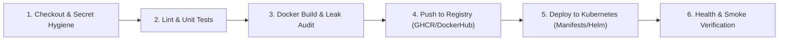

# Enterprise CI/CD with Jenkins & Kubernetes

This directory provides the complete setup to run **Jenkins** locally or on your server, configure credentials, and run the automated [Jenkinsfile](../../Jenkinsfile) pipeline deploying to **Kubernetes**.

---

## 1. Quickstart: Run Jenkins with Docker Compose

A pre-configured Docker Compose file running Jenkins with a Docker-in-Docker (`dind`) sidecar is provided in [`docker-compose.yml`](./docker-compose.yml).

### Step 1: Start Jenkins
```powershell
cd "c:\KGAS PROJECT\infra\jenkins"
docker compose up -d
```

### Step 2: Access Jenkins UI
1. Open your browser: `http://localhost:8080`
2. Retrieve the initial admin password:
   ```powershell
   docker exec jenkins-controller cat /var/jenkins_home/secrets/initialAdminPassword
   ```
3. Complete the setup wizard and install suggested plugins.

### Step 3: Install Required Jenkins Plugins
Under **Manage Jenkins → Plugins → Available Plugins**, install:
- **Pipeline**
- **Docker Pipeline**
- **Kubernetes CLI** (`withKubeConfig` step)
- **Git**
- **AnsiColor**

---

## 2. Configure Credentials in Jenkins

In Jenkins, go to **Manage Jenkins → Credentials → System → Global credentials**:

| Credential ID | Type | Description |
| :--- | :--- | :--- |
| `docker-registry-credentials` | Username with password | GitHub Personal Access Token or Docker Hub credentials for image push |
| `k8s-kubeconfig` | Secret file | Your cluster's `kubeconfig` file (or `~/.kube/config`) |

---

## 3. Create the Pipeline Job

1. Click **New Item** → Name: `dockerized-service-pipeline` → Select **Pipeline** → Click **OK**.
2. Scroll to the **Pipeline** section:
   - **Definition:** `Pipeline script from SCM`
   - **SCM:** `Git`
   - **Repository URL:** `https://github.com/ADITYAGUPTA112/Dockerized-Service-Architecture-Planning.git`
   - **Branch Specifier:** `*/main`
   - **Script Path:** `Jenkinsfile`
3. Click **Save** and click **Build with Parameters**!

---

## 4. Pipeline Stages Overview



1. **Checkout & Secret Hygiene:** Asserts `.env` is NOT tracked in Git and workspace is clean.
2. **Lint & Unit Tests:** Runs `npm ci`, `npm run lint`, and `npm test` (all 24 tests).
3. **Docker Build & Leak Audit:** Builds `node:22-alpine` image and audits `/app/.env` absence and `uid=1000(node)`.
4. **Push to Registry:** Authenticates with credentials and pushes versioned tag + `latest`.
5. **Deploy to Kubernetes:** Applies [`k8s/manifests/`](../../k8s/manifests/) or [`k8s/helm/`](../../k8s/helm/dockerized-service/), executes rolling update, and monitors rollout status.
6. **Smoke Test & Verification:** Queries pod health, readiness probe, and endpoints.
